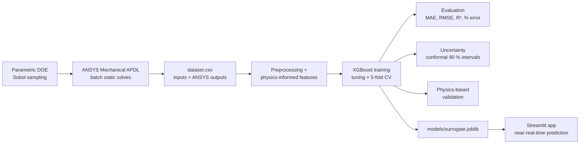
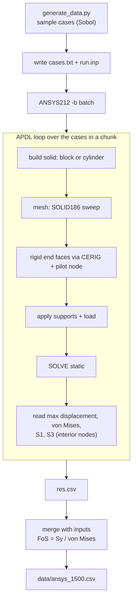
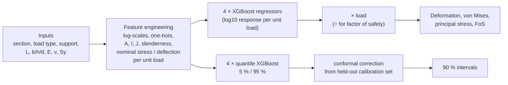
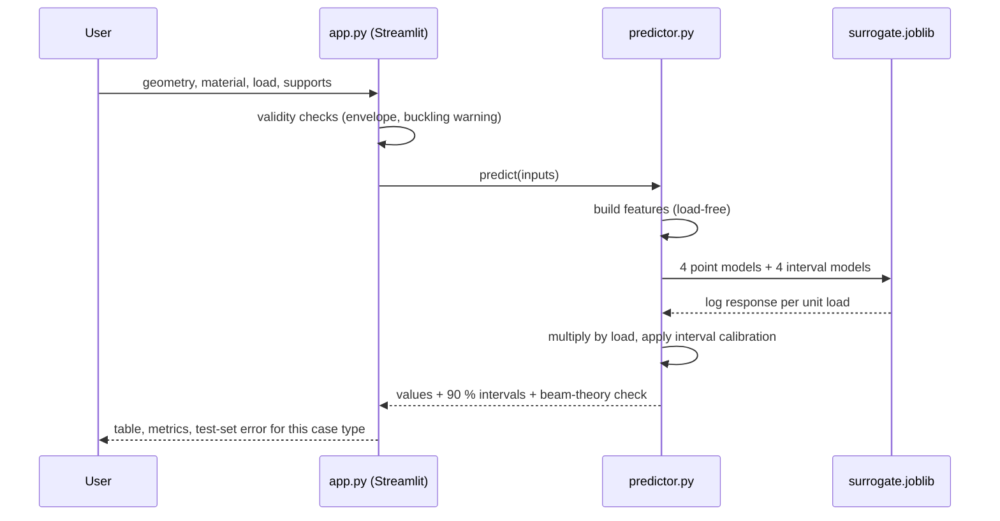
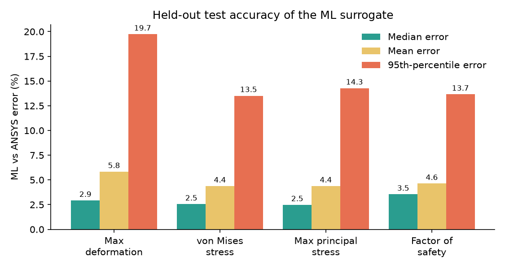
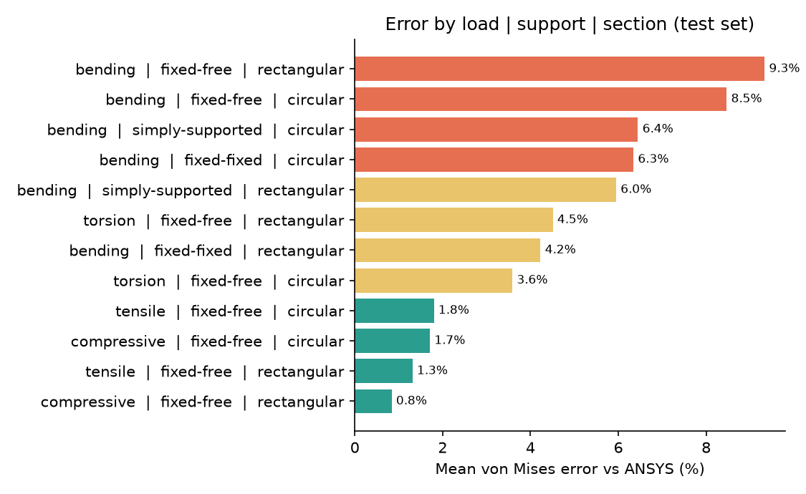
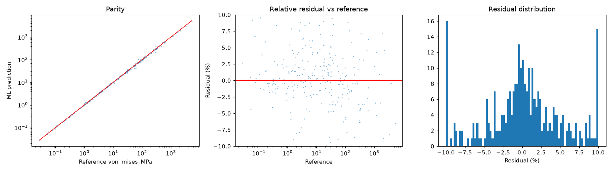
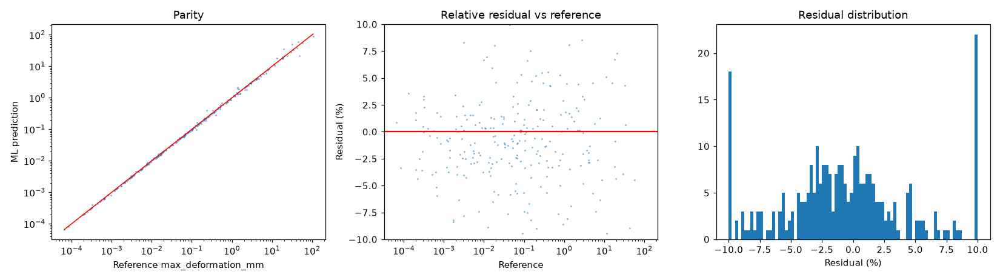

# ML Surrogate for ANSYS Static Structural Analysis

A machine-learning model (XGBoost) that predicts the structural response of simple bars and shafts **in milliseconds**, trained on and validated against **ANSYS Mechanical APDL** static-structural simulations.

Enter geometry, material, load and supports → get **maximum deformation**, **von Mises stress**, **maximum principal stress** and **factor of safety**, each with a calibrated 90 % prediction interval.

> ANSYS is used only as the high-fidelity **data generator and validation reference**. The final tool is the ML surrogate, not an FE solver.

---

## Contents
1. [Scope](#1-scope)
2. [How it works](#2-how-it-works)
3. [Results](#3-results)
4. [Repository structure](#4-repository-structure)
5. [Quick start](#5-quick-start)
6. [Method details](#6-method-details)
7. [Validation](#7-validation)
8. [Limitations](#8-limitations)
9. [Reproducing with your own ANSYS](#9-reproducing-with-your-own-ansys)
10. [Future work](#10-future-work)

---

## 1. Scope

| Item | Supported |
|---|---|
| Cross-section | Rectangular (b × h), circular (d) |
| Load type | Tensile, compressive, bending (point load), torsion |
| Supports | Fixed–free (tension, compression, torsion, bending), simply-supported (bending), fixed–fixed (bending) |
| Material inputs | Young's modulus, Poisson's ratio, yield strength |
| Outputs | Max deformation [mm], von Mises [MPa], max principal [MPa], factor of safety |

**Training envelope** (units: mm, N, MPa, N·mm)

| Parameter | Range |
|---|---|
| Length L | 100 – 1500, with L ≥ 5 × largest section dimension |
| Width b, height h, diameter d | 10 – 100 |
| Young's modulus E | 60 000 – 220 000 |
| Poisson's ratio ν | 0.25 – 0.35 |
| Yield strength S<sub>y</sub> | 100 – 1000 |
| Axial force | 100 – 100 000 N |
| Bending force | 50 – 10 000 N |
| Torque | 10 000 – 10 000 000 N·mm |

Predictions outside these ranges are extrapolation and should not be trusted.

---

## 2. How it works

### End-to-end pipeline



### Automated ANSYS data generation

One ANSYS launch solves a chunk of 20 cases in an APDL loop. Finished chunks are cached, so an interrupted run resumes where it stopped.



### The ML model

The model predicts the response **per unit load**. In linear statics, deformation and stress are exactly proportional to the load (and factor of safety inversely proportional), so the load is factored out and multiplied back in afterwards. This makes the load-scaling exact by construction and removes the widest input range from what the model has to learn.



### What happens when you click in the app



---

## 3. Results

Held-out test set (≈ 290 cases, 20 % split), ML prediction compared with the **ANSYS** result:

| Output | R² (log) | R² (physical) | Median error | Mean error | 95th-pct error | 90 % interval coverage |
|---|---|---|---|---|---|---|
| Max deformation | 0.9988 | 0.931 | 2.9 % | 5.8 % | 19.7 % | 89 % |
| von Mises stress | 0.9993 | 0.996 | 2.6 % | 4.4 % | 13.5 % | 94 % |
| Max principal stress | 0.9992 | 0.995 | 2.5 % | 4.4 % | 14.3 % | 93 % |
| Factor of safety | 0.9994 | 0.999 | 3.5 % | 4.6 % | 13.7 % | 89 % |

5-fold cross-validation R² (log space) is 0.9985 – 0.9988 for all four outputs. MAE, RMSE and residual data for every output are in `reports/metrics.json`.



**Where the model is weaker.** Tension and compression are reproduced to about 1 – 2 %, torsion to 4 – 5 %, and bending to 4 – 9 %, where the ANSYS stress depends more on slenderness and the read-out location.



**Physics-informed features matter.** With raw inputs only, the mean error is 22 – 30 %; with the engineered features it is 4 – 6 %.

### Residual analysis (parity, residual vs reference, residual histogram)

| von Mises stress | Max deformation |
|---|---|
|  |  |

Plots for the other two outputs are in `reports/`. Every test case, with the ANSYS value, ML prediction and percentage error side by side, is in `reports/test_predictions_vs_reference.csv`.

<!-- After taking a screenshot of the app, save it as docs/app_screenshot.png and uncomment:
### The interactive app

-->

---

## 4. Repository structure

```
.
├── physics.py            closed-form beam / torsion solver (features + sanity checks)
├── features.py           feature engineering (load-free, physics-informed)
├── generate_data.py      Sobol design of experiments + data assembly
├── ansys_adapter.py      ANSYS Mechanical APDL batch driver (2021 R2), resumable
├── train.py              tuning, cross-validation, metrics, intervals, physics checks
├── predictor.py          inference wrapper (used by the app)
├── app.py                Streamlit interface
├── make_figures.py       builds the README charts from reports/metrics.json
├── requirements.txt
├── data/                 ansys_1500.csv (inputs + ANSYS outputs)
├── models/               surrogate.joblib
├── reports/              metrics.json, residual plots, test-set predictions vs ANSYS
└── docs/                 README figures
```

---

## 5. Quick start

```bash
pip install -r requirements.txt

# Train on the provided ANSYS dataset
python train.py --data data/ansys_1500.csv

# Launch the interactive app
streamlit run app.py
```

Then open http://localhost:8501.

Useful options:

| Command | Purpose |
|---|---|
| `python train.py --data <csv> --iters 20` | more hyperparameter search iterations |
| `python train.py --max_defl_frac 0` | disable the small-deflection filter |
| `python make_figures.py` | rebuild `docs/*.png` from `reports/metrics.json` |

---

## 6. Method details

### 6.1 Data generation
* **Design of experiments:** scrambled Sobol sequences (space-filling), with log-uniform sampling of lengths, dimensions and loads. Cases are spread evenly over the six load/support combinations (252 each, both sections included, 1 512 in total).
* **FE model in ANSYS:** solid model extruded along Z, `SOLID186` swept mesh (≈ 4 divisions across the smallest dimension), linear-elastic isotropic material, small-deflection static analysis.
* **Supports and loads:**
  * *Fixed–free:* fixed face at z = 0; load or torque applied at a pilot node rigidly attached to the free end (`CERIG`).
  * *Simply-supported:* pilot nodes at both ends, pinned, with the load spread over a few nodes at midspan on the top face.
  * *Fixed–fixed:* both end faces fixed, midspan load as above.
* **Result extraction (identical for every case):**
  * Deformation = maximum total displacement (for midspan-load bending, over the lower half, which skips the local dent at the load point).
  * Stresses = maximum nodal averaged value in the **interior** (z from D to L − D, D = largest section dimension), which avoids end-face and support artefacts that depend on mesh size. For midspan-load bending, only the tension-side half is used to skip the load-point spike.
  * Max principal = max(|S1|, |S3|); factor of safety = S<sub>y</sub> / von Mises.
  * Consequence: cantilever bending stress is read one section-size from the root, so it is slightly below the theoretical root value.

### 6.2 Preprocessing and features
* Positive, multi-decade outputs are modelled in **log₁₀ space**.
* Cases with deformation above 10 % of the length are removed (linear small-deflection theory does not apply there). In this dataset 65 of 1 512 cases were dropped.
* Features: log-scaled dimensions and material properties, one-hot section / load / support, section area, second moment, torsion constant, slenderness, and *nominal stress and deflection per unit load* from beam / Saint-Venant theory. The load itself is deliberately not an input.

### 6.3 Model and training
* Four `XGBRegressor` models (one per output), `hist` tree method.
* Hyperparameters chosen by `RandomizedSearchCV` (n_estimators, max_depth, learning rate, subsample, column subsample, min_child_weight, L2 regularisation).
* Performance by 5-fold cross-validation on the training split plus a held-out 20 % test set (stratified by load type and support).

### 6.4 Uncertainty
* Quantile XGBoost models (5 % and 95 %) give raw intervals.
* A **conformalised quantile regression** step uses a 15 % calibration slice of the training data to widen the intervals so they cover ≈ 90 % of new cases. Coverage on the test set is reported above.

---

## 7. Validation

### 7.1 Against ANSYS
MAE, RMSE, R², percentage errors (mean, median, 95th percentile), per-case error breakdown and residual plots on data the model never saw (`reports/`).

### 7.2 Physics-based checks

| Check | Result |
|---|---|
| Support stiffness order (fixed–free deflects more than simply-supported, which deflects more than fixed–fixed) | 100 % of test cases |
| Stiffer material (E × 1.2) gives smaller deflection | 97.9 % |
| Factor of safety ≈ S<sub>y</sub> / predicted von Mises | median deviation 4.2 % |
| von Mises / principal ratio matches theory (1 for axial and bending, √3 for torsion) | median deviation 2.1 % |
| Load doubling doubles deformation and stress, halves FoS | exact by construction (per-unit-load formulation) |

The app also warns when the compressive load exceeds the Euler buckling load (linear static results are meaningless beyond it) and when the predicted factor of safety is below 1.

---

## 8. Limitations
* **Narrow domain.** Only the geometries, loads and supports above. No notches, holes, fillets, contact or complex assemblies.
* **Linear elastic, small deflection.** No plasticity, buckling or large-deformation effects.
* **Model-dependent ground truth.** The learned values reflect the FE setup and extraction rules in §6.1 (mesh, rigid end faces, interior read-out), not a universal "true" stress.
* **Small dataset.** 1 512 ANSYS solves. The test set (≈ 290 cases) comes from the same sampling plan as the training data; an independent set of fresh ANSYS runs would be a stronger test. Errors in the tail (95th percentile 13 – 20 %) are noticeably larger than the median.
* **Envelope only.** Do not use outside the ranges in §1.

Not a substitute for a full FE analysis or a code-compliant design check.

---

## 9. Reproducing with your own ANSYS

Requirements: ANSYS Mechanical APDL (developed and tested with **2021 R2**) with a licence, on the same machine.

```bash
# 1. Check the ANSYS driver on 7 cases; prints ANSYS vs closed-form
python ansys_adapter.py --test

# 2. Generate the dataset (about 1 hour for 1 500 cases on a laptop)
python generate_data.py --source ansys --n 1500 --out data/ansys_1500.csv

# 3. Train and evaluate
python train.py --data data/ansys_1500.csv
```

Notes:
* If ANSYS is installed elsewhere, pass `--ansys_exe "<path to ANSYS212.exe>"`.
* Keep the machine awake and plugged in. If a run is interrupted, re-run the same command; finished chunks are reused.
* Do not change `--n` between attempts (the cache is tied to the exact case list).
* `python generate_data.py` (without `--source ansys`) creates a dataset from closed-form beam theory instead. This is useful for testing the pipeline without ANSYS, but models trained on it only learn the formulas.

---

## 10. Future work
* More ANSYS cases, weighted toward bending and torsion, where errors are highest.
* Independent hold-out set of fresh ANSYS runs; k-fold over sampling seeds.
* Additional sections (hollow tube, I-beam), distributed loads, combined loading.
* Active learning: solve new ANSYS cases where the model's interval is widest.
* Nonlinear extensions (plasticity, large deflection).

---

## Acknowledgements and notes
ANSYS is a trademark of ANSYS, Inc.; this project is not affiliated with or endorsed by ANSYS. The ANSYS-generated dataset in `data/` was produced by the author's own licensed installation.


